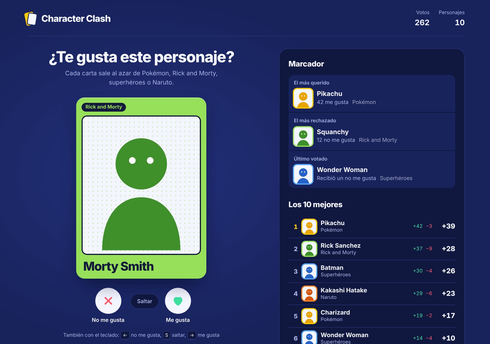

# Character Clash

Una app para votar por personajes de **Pokémon, Rick and Morty, superhéroes y Naruto**. Cada carta sale al azar de una API pública distinta; tú decides si te gusta o no, y el marcador muestra en tiempo real cuáles son los favoritos y los más rechazados.

**Demo:** _próximamente_ · **API:** _próximamente_



## Funcionalidades

- Carta aleatoria de cuatro universos, con la siguiente precargada para que votar sea instantáneo.
- Votar con botones o con el teclado (`←` no me gusta, `→` me gusta, `S` saltar).
- Marcador con el personaje más querido, el más rechazado y el último votado.
- Ranking de los 10 mejores por puntaje (me gusta − no me gusta).
- Diseño responsive, accesible (foco visible, `aria-live`, movimiento reducido).

## Stack

| Capa | Tecnologías |
| --- | --- |
| Frontend | React 18, TypeScript, Vite, CSS puro |
| Backend | NestJS 11, TypeScript, Mongoose, class-validator |
| Base de datos | MongoDB (Atlas) |
| Despliegue | Vercel (frontend) y Render (API) |

## Arquitectura

```
frontend (React)  ──HTTP──▶  API (NestJS)  ──▶  MongoDB
                                  │
                                  └──▶  PokéAPI · Rick and Morty API · SuperHero API · Dattebayo (Naruto)
```

```
backend/src
├── main.ts                      # arranque: prefijo /api, CORS, validación global
├── app.module.ts                # configuración, conexión a Mongo, rate limiting
├── health.controller.ts         # GET /api/health
├── character-sources/           # una clase por API externa + selección aleatoria con reintentos
│   ├── character-source.ts      # contrato común (interfaz CharacterSource)
│   ├── character-sources.service.ts
│   └── sources/                 # pokemon, rick-and-morty, superhero, naruto
└── characters/                  # votos, marcador y ranking
    ├── characters.controller.ts
    ├── characters.service.ts
    ├── dto/                     # validación de entrada
    └── schemas/                 # modelo de Mongoose
```

Decisiones técnicas destacadas:

- **Votos atómicos:** cada voto es un único `findOneAndUpdate` con `$inc` y `upsert`, así dos votos simultáneos nunca se pisan.
- **Fuentes intercambiables:** cada API externa implementa la misma interfaz. Si una falla o el personaje no tiene imagen, el servicio reintenta con otra. Agregar un universo nuevo es crear una clase.
- **Configuración por entorno:** puerto, CORS, conexión a Mongo y API keys viven en `.env`; la app no arranca si falta una variable obligatoria.
- **Protección básica:** validación estricta de los datos de entrada y límite de peticiones por IP (`@nestjs/throttler`).

## Endpoints

| Método | Ruta | Descripción |
| --- | --- | --- |
| `GET` | `/api/characters/random` | Personaje aleatorio de cualquier universo |
| `POST` | `/api/votes` | Registra un voto `{ name, image, universe, type: "like" \| "dislike" }` |
| `GET` | `/api/stats` | Total de votos, más querido, más rechazado y último votado |
| `GET` | `/api/ranking?limit=10` | Ranking por puntaje (máx. 50) |
| `GET` | `/api/health` | Estado de la API |

## Correr el proyecto en local

Requisitos: Node.js 20 o superior y una base de datos MongoDB (local o un cluster gratis en [MongoDB Atlas](https://www.mongodb.com/atlas)).

**1. API**

```bash
cd backend
cp .env.example .env      # completa MONGO_URI
npm install
npm run start:dev         # http://localhost:3001/api
```

**2. Frontend** (en otra terminal)

```bash
cd frontend
cp .env.example .env
npm install
npm run dev               # http://localhost:5173
```

> Los superhéroes son opcionales: si quieres incluirlos, consigue un token gratis en [superheroapi.com](https://superheroapi.com) y ponlo en `SUPERHERO_API_KEY`. Sin token, la app usa los otros tres universos.

## Despliegue

1. **MongoDB Atlas:** crea un cluster gratuito, un usuario de base de datos y permite el acceso desde `0.0.0.0/0`. Copia la cadena de conexión.
2. **Render (API):** _New → Blueprint_ y elige este repositorio (usa `render.yaml`). Completa `MONGO_URI` y, después del paso 3, `CORS_ORIGIN` con la URL de Vercel.
3. **Vercel (frontend):** importa el repositorio, elige `frontend` como _Root Directory_ y agrega la variable `VITE_API_URL=https://<tu-api>.onrender.com/api`.

> En el plan gratuito de Render la API se duerme tras 15 minutos sin uso; la primera carga después de eso puede tardar unos segundos.

## Historia del proyecto

Empezó como una prueba técnica en 2024 (dos repositorios separados). En 2026 lo reconstruí: lo uní en un solo repositorio, reorganicé el backend por funcionalidades, saqué las credenciales del código, hice los votos atómicos, agregué validación y rate limiting, y rediseñé por completo la interfaz.

## Autor

**Sebastián Castaño Ospina** · Ingeniero de sistemas y computación · [GitHub](https://github.com/secasospina)

Licencia [MIT](LICENSE).
